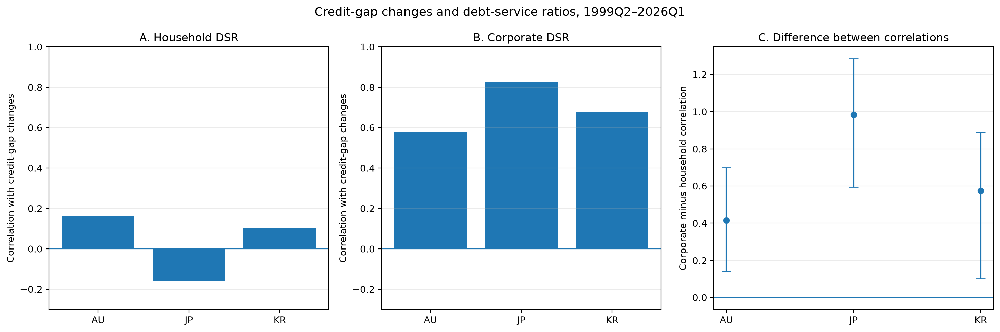
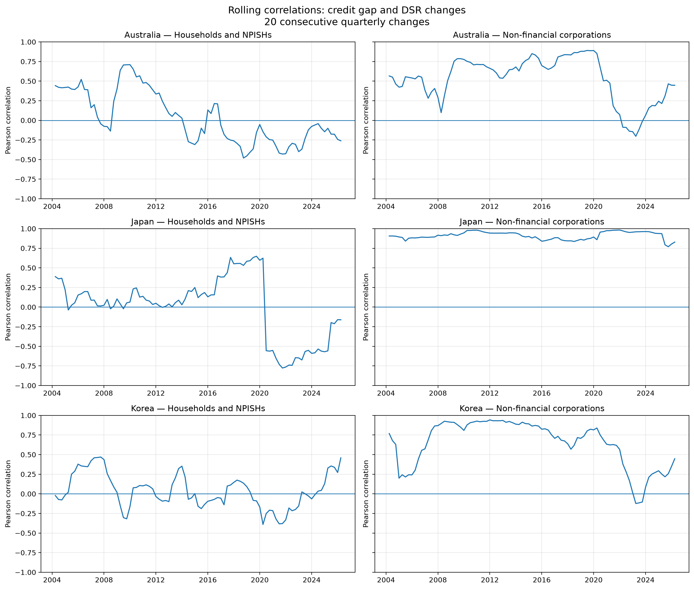
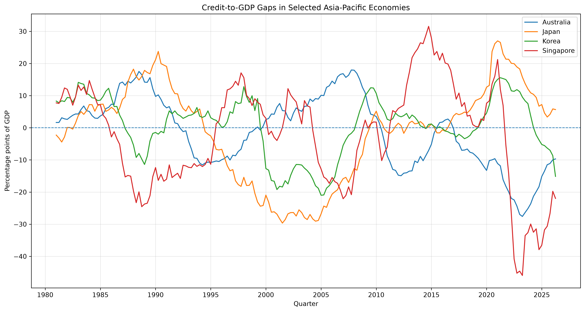
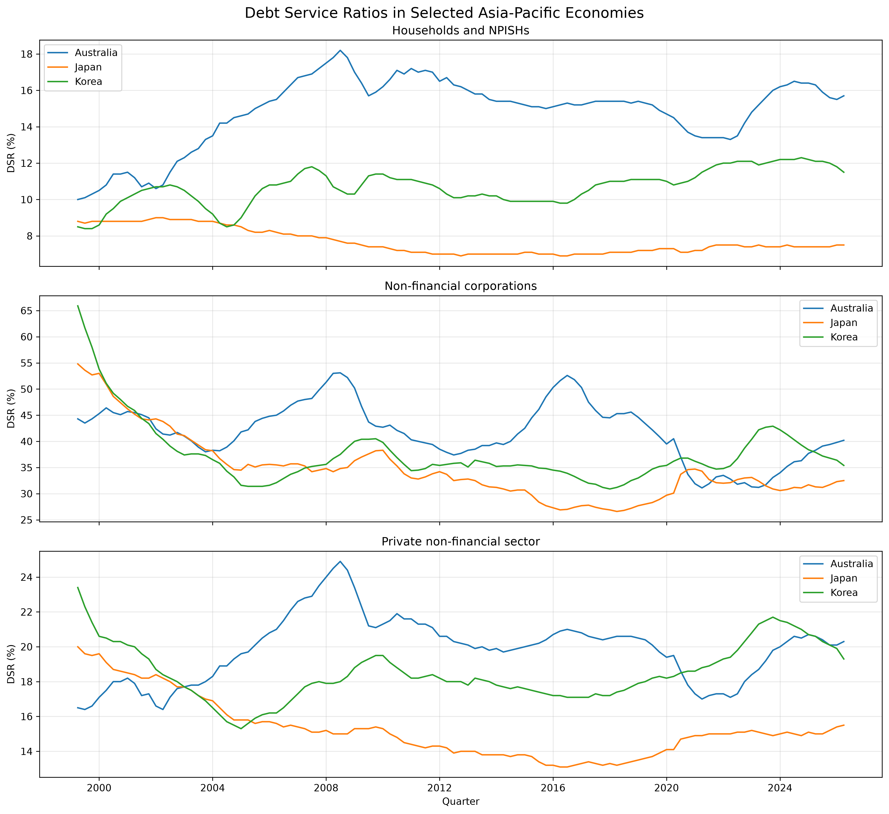
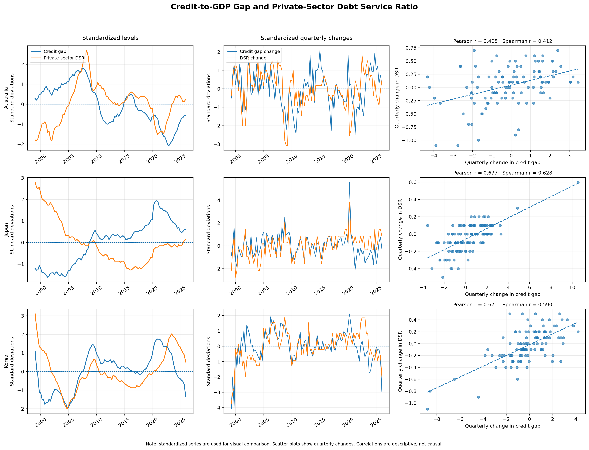

# Credit Gaps and Debt-Service Pressures in Asia-Pacific

## A sectoral comparison of Australia, Japan and Korea

**Research note | October 2026**

## Executive summary

This study examines whether quarterly changes in the credit-to-GDP gap are associated differently with debt-service pressures faced by households and non-financial corporations in Australia, Japan and Korea. Using quarterly observations from 1999Q1 to 2026Q1, the analysis combines credit-to-GDP gap data with debt-service ratios (DSRs), distinguishes household and corporate sectors, and evaluates the stability of the results through outlier diagnostics, rolling correlations and moving-block bootstrap inference.

Three findings stand out.

1. Changes in the credit gap are positively associated with changes in the corporate DSR in all three economies. Pearson correlations range from 0.578 in Australia to 0.825 in Japan.
2. The corresponding household relationships are much weaker. Household Pearson correlations range from −0.158 in Japan to 0.163 in Australia.
3. Paired moving-block bootstrap comparisons indicate that the corporate correlation exceeds the household correlation in all three countries. The 95% confidence intervals for the difference remain above zero across block lengths of two, four and eight quarters.

These results identify a consistent sectoral pattern in the sample. They do not establish causality, prove that corporate borrowers are more vulnerable overall, or demonstrate that the credit gap predicts future debt-service pressures.

## 1. Research question and motivation

Credit developments and debt-servicing pressures capture related but distinct aspects of financial vulnerability. The credit-to-GDP gap measures the deviation of the credit-to-GDP ratio from its estimated long-term trend. The debt-service ratio measures debt-service payments relative to income.

A country can experience changes in credit conditions without an equivalent contemporaneous movement in debt-service burdens. The relationship may also differ across borrowers: household and corporate debt structures, income dynamics and exposure to financial conditions are not identical.

This study therefore asks:

> Are quarterly changes in the credit-to-GDP gap more strongly associated with changes in corporate debt-service ratios than with changes in household debt-service ratios in Australia, Japan and Korea?

The analysis is descriptive and comparative. It is intended to identify empirical patterns that merit further investigation, rather than to estimate a causal mechanism.

## 2. Data and methodology

### Data and sample

The analysis uses quarterly credit-to-GDP gap and debt-service ratio series for Australia (AU), Japan (JP) and Korea (KR).

The common sample for the sectoral analysis runs from 1999Q1 to 2026Q1, providing 109 quarterly level observations per country-sector group. First differences reduce the sample to 108 quarterly changes, from 1999Q2 to 2026Q1.

Two DSR sectors are analysed separately:

- **Households (H):** household debt-service pressures.
- **Non-financial corporations (N):** corporate debt-service pressures.

The private non-financial sector aggregate is not treated as an independent sector in this comparison because it includes households and non-financial corporations.

The credit-to-GDP gap is measured in percentage points of GDP. The DSR is expressed as a percentage. The analysis focuses on their quarterly changes to reduce the influence of long-run co-movement in levels.

### Empirical approach

For each country and sector, the study calculates Pearson and Spearman correlations between quarterly changes in the credit gap and DSR.

Robustness checks include:

1. **Extreme-change diagnostics:** correlations are recalculated after flagging quarters with unusually large changes in either variable.
2. **Leave-one-quarter-out analysis:** each observation is removed in turn to identify potentially influential quarters.
3. **Rolling correlations:** correlations are estimated over windows of 20 consecutive quarterly changes to assess variation over time.
4. **Moving-block bootstrap inference:** 2,000 bootstrap replications are used to estimate 95% percentile confidence intervals, preserving short sequences of adjacent quarterly observations.
5. **Block-length sensitivity:** inference is repeated with block lengths of two, four and eight quarters.
6. **Direct sector comparison:** a paired moving-block bootstrap estimates the difference between corporate and household Pearson correlations.

The main sector comparison uses a four-quarter bootstrap block. The random seed is fixed for reproducibility.

## 3. Main findings

### Corporate DSR changes are more strongly associated with credit-gap changes

| Country | Household correlation | Corporate correlation | Corporate minus household |
|---|---:|---:|---:|
| Australia | 0.163 | 0.578 | 0.415 |
| Japan | −0.158 | 0.825 | 0.983 |
| Korea | 0.102 | 0.676 | 0.574 |

*Note: Entries are Pearson correlations between quarterly changes. Differences are calculated from the corresponding sector-specific correlations.*

The corporate association is positive in every country and strongest in Japan. Household correlations are substantially weaker and close to zero in Australia and Korea; Japan's household Pearson correlation is negative.

The pattern is not limited to Pearson correlation. The corporate-sector Spearman correlations are also positive in all three countries, suggesting that the main result is not exclusively a consequence of a linear relationship.

### Figure 1. Sectoral correlations and paired bootstrap intervals

*Note: Pearson correlations between quarterly changes in the credit-to-GDP gap and debt-service ratios over 1999Q2–2026Q1. The right-hand panel shows the corporate-minus-household correlation difference and 95% paired moving-block bootstrap percentile confidence intervals, using four-quarter blocks and 2,000 replications.*

### Direct bootstrap comparison supports the sectoral difference

The four-quarter paired moving-block bootstrap produces the following 95% confidence intervals for the corporate-minus-household Pearson correlation difference:

| Country | Difference | 95% bootstrap confidence interval |
|---|---:|---:|
| Australia | 0.415 | [0.141, 0.699] |
| Japan | 0.983 | [0.593, 1.285] |
| Korea | 0.574 | [0.102, 0.888] |

All three intervals lie above zero. The estimated difference is largest in Japan, followed by Korea and Australia.

The confidence intervals also remain above zero when the block length is changed to two or eight quarters. This supports the stability of the sectoral contrast under the block-length choices examined, although it does not eliminate uncertainty arising from other modelling assumptions or data limitations.

## 4. Robustness and time variation

The results are supported by several complementary diagnostics.

**Influential observations.** Removing individual quarters changes the estimated correlations, but no single observation eliminates the positive corporate association in any of the three countries. The Japanese household relationship is less stable and remains a more uncertain feature of the data.

**Extreme changes.** After quarters with unusually large changes are flagged and excluded in a diagnostic exercise, the corporate correlations remain positive: approximately 0.595 in Australia, 0.709 in Japan and 0.534 in Korea. This suggests that the main corporate pattern is not explained solely by the flagged observations. The exclusion is a sensitivity check, not a proposed data-cleaning rule.

**Rolling correlations.** Using windows of 20 consecutive quarterly changes, the median corporate Pearson correlation is 0.583 in Australia, 0.914 in Japan and 0.736 in Korea. Corporate correlations are positive in 92.1%, 100% and 96.6% of the respective windows. Household rolling correlations, by contrast, have medians close to zero.

### Figure 2. Rolling correlations over time

*Note: Rolling Pearson correlations based on windows of 20 consecutive quarterly changes. Overlapping windows are descriptive and should not be interpreted as independent statistical tests.*

These rolling estimates indicate that the corporate association is generally positive across the sample, while also varying over time. Because the windows overlap, they should be interpreted as descriptive evidence rather than as independent statistical tests.

### Supplementary figures

The repository also contains contextual figures that can support the analysis. They should be retained only if their labels, series definitions and time coverage are verified against the scripts that generated them.

**Figure 3. Credit-to-GDP gap across four economies**

**Figure 4. Debt-service ratios across countries and sectors**

**Figure 5. Credit-gap and debt-service diagnostics**

## 5. Interpretation and limitations

The evidence is consistent with a stronger contemporaneous association between credit-gap changes and corporate debt-service changes than between credit-gap changes and household debt-service changes in the three economies studied.

Several limitations qualify this conclusion.

1. **Correlation is not causation.** The analysis does not identify whether credit developments influence debt service, whether debt-service conditions affect credit dynamics, or whether both respond to other economic factors.
2. The sample is observational and spans different economic regimes. Structural changes, macroeconomic shocks and country-specific institutions may affect the estimated relationships.
3. Differencing reduces the influence of trends but does not, by itself, resolve every concern related to non-stationarity, lagged relationships or omitted variables.
4. The credit-to-GDP gap depends on an estimated trend. Trend estimates can be sensitive to the filtering method and to endpoint revisions, so the underlying credit-gap series carries measurement uncertainty.
5. The bootstrap confidence intervals are conditional on the resampling design and the observed sample. They should not be interpreted as proof that the same relationships will hold in other periods or economies.

## 6. Conclusion and next steps

Across Australia, Japan and Korea, quarterly changes in corporate debt-service ratios are more strongly associated with changes in the credit-to-GDP gap than are household DSR changes. The estimated sectoral differences remain positive under the moving-block bootstrap specifications examined.

The main contribution is a transparent, reproducible comparison that combines data validation, sectoral analysis, influence diagnostics, rolling correlations and direct bootstrap inference.

A natural extension would test whether the sectoral pattern persists after controlling for macroeconomic conditions, investigate lagged relationships, assess alternative credit-gap specifications and evaluate whether the credit gap contains information about subsequent changes in debt-service pressures.

The results provide a starting point for further macro-financial analysis, not a causal or predictive claim.

## Data and reproducibility note

### Official data sources

- **Credit-to-GDP gaps:** Bank for International Settlements (BIS), BIS Data Portal, [Credit-to-GDP gaps](https://data.bis.org/topics/CREDIT_GAPS).
- **Debt-service ratios:** Bank for International Settlements (BIS), BIS Data Portal, [Debt-service ratios](https://data.bis.org/topics/DSR).

Both datasets are quarterly. The credit-to-GDP gap is defined by the BIS as the difference between the credit-to-GDP ratio and its long-run trend. The DSR measures debt-service costs, including interest payments and principal amortisations, relative to income.

### Data provenance and reproducibility

- **Local source files:** `WS_CREDIT_GAP_csv_flat (1).csv` and `WS_DSR_csv_flat (1).csv`.
- **Local file timestamps:** 14 October 2026, 04:37, for the credit-gap file; 15 October 2026, 03:56, for the DSR file. These are local file modification timestamps and are not treated as verified download dates.
- **Extraction date:** to be confirmed from the original download records, if available.
- **Coverage:** the sectoral comparison covers Australia, Japan and Korea over the common sample used in the analysis. Singapore is excluded from the sectoral comparison because the DSR dataset used here does not provide the required observations for that country.
- **Reproduction:** the project includes Python scripts in `src/`, processed datasets in `data/processed/`, and figures in `figures/`. The execution environment and package versions should be documented before external submission.
- **Methodological limitations:** the analysis is descriptive and does not establish causality. Credit-gap estimates are sensitive to trend estimation and endpoint revisions. DSR levels are estimates and are generally more informative for within-country changes over time than for direct comparisons of absolute levels across countries.

**Before external submission:** verify the data access date and series identifiers; rerun the analysis from the committed data and scripts; confirm that the tables and figures reproduce; and ensure that all figure paths resolve in the repository.
